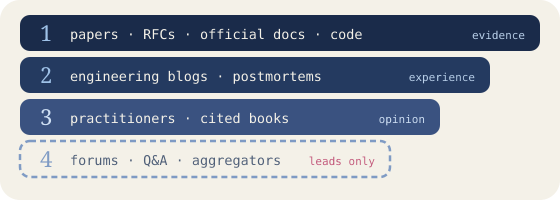
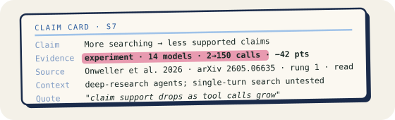

<p align="center">
  
</p>

<h1 align="center">literature-review</h1>

<p align="center"><em>An Agent Skill that makes the model fetch, read and cite — instead of answering from memory.</em></p>

<p align="center">
  <a href="https://agentskills.io"></a>
  
  
</p>

Ask *"what is the best practice for X?"* and get a cited literature
review back: a sources table where every row was actually fetched and read,
findings sorted into consensus / disagreement / open, and a recommendation
whose confidence is derived from the evidence rather than from how sure the
prose sounds. One [`SKILL.md`](skills/literature-review/SKILL.md); works in
any agent that reads the Agent Skills format.

Most research skills optimise for *more sources*. This one optimises for
*a decision*: it ranks sources on a four-rung ladder (papers and specs
before blogs before forums), writes one **claim card** per finding with
its evidence type (experiment, measurement, production experience, spec,
opinion), sorts findings into **consensus / disagreement / open**, labels
what everyone repeats but nobody can source as **folklore**, and derives
the confidence of its recommendation from the cards rather than from how
sure the prose sounds.

```bash
claude plugin install literature-review --marketplace samasarvii/literature-review   # Claude Code
npx skills add samasarvii/literature-review                                          # Codex, Cursor, Gemini CLI, ~75 others
gh skill install samasarvii/literature-review --all                                  # GitHub CLI (preview)
```

## Install

Pick **one** route per agent. Installing the same skill through two routes
gives the agent every skill twice.

| Agent | Command |
|---|---|
| Claude Code (≥ v2.1.292) | `claude plugin install literature-review --marketplace samasarvii/literature-review` — or in two steps: `claude plugin marketplace add samasarvii/literature-review`, then `claude plugin install literature-review@samasarvii` |
| Codex, Cursor, Gemini CLI, and ~75 others | `npx skills add samasarvii/literature-review` (add `-g` for a global install) |
| GitHub CLI (preview) | `gh skill install samasarvii/literature-review --all` (`--agent claude-code` etc. to pick the agent) |
| claude.ai (Pro/Max/Team/Enterprise) | `cd skills && zip -r literature-review.zip literature-review/` — the folder must be the top level of the zip — then upload it under *Settings → Capabilities → Skills → Upload skill* and turn it on under *Customize → Skills* |
| By hand | Copy `skills/literature-review/` to `~/.claude/skills/` (user) or `.claude/skills/` (project), or your agent's skills directory |

The skill has no hooks and makes no network calls of its own while
researching; it only instructs the agent. Two optional stdlib-only
scripts run at the end, if a shell is available: `check_sources.py`
re-fetches every cited link and looks for each quoted passage on the page,
`validate_report.py` checks the report against the template. Read
`skills/literature-review/SKILL.md` before installing, as you would with
any skill.

## What it does

Given a question, the agent:

1. **Frames** the decision the review serves and splits it into three to
   six sub-questions.
2. **Gathers** sources and ranks them on a **source ladder**: papers, RFCs
   and official docs first; engineering blogs and postmortems second;
   practitioners third; forums only as leads to follow back to the original.
   Every source is fetched and read before it can be cited; a search snippet
   is a lead, not a citation. Breadth is capped per sub-question.

   
3. **Extracts a claim card** per finding, with the evidence type
   (experiment, measurement, production experience, specification, or
   opinion) and a verbatim quote the final check looks for on the page.

   
4. **Sorts** findings into *consensus / disagreement / open*, and labels
   what everyone repeats but nobody can source as folklore.
5. **Recommends** for *your* context, with a confidence level derived from
   the cards (not from how sure the prose feels) and the one fact that would
   flip the recommendation.
6. **Writes** a Markdown report with a full sources table into your repo,
   then **checks** it: every link re-fetched, every quote found, every
   cited row marked *read* — and says so in a Verification line.

Say "quick" and it runs a light pass (two sub-questions, five to eight
sources) with the same report shape.

## Why these rules

The design follows what has been measured about LLMs doing research:

- Models writing from memory fabricate 18–55% of their citations
  ([Walters & Wilder 2023, Sci Rep](https://www.nature.com/articles/s41598-023-41032-5));
  with web access that drops to 3–13% but does not vanish, and a link check
  plus a correction step brings it under 1%
  ([Rao, Wong & Callison-Burch 2026](https://arxiv.org/abs/2604.03173)).
  So the skill fetches before it cites.
- A working link is not a supported claim: frontier models' links resolve
  94–100% of the time, but only 39–77% of cited claims are actually supported
  by the page, and more searching makes this worse, not better
  ([Onweller et al. 2026](https://arxiv.org/abs/2605.06635)). So the skill
  caps breadth and checks claims against pages at the end.
- On contested questions, 52–95% of AI answers present only one side
  ([Venkit et al. 2025, DeepTRACE](https://arxiv.org/abs/2509.04499)). So
  the skill reports disagreement as a finding rather than smoothing it over.

The sources for every number above are in
[`examples/2026-10-16-agent-skills.md`](examples/2026-10-16-agent-skills.md),
a review this skill produced about agent skills themselves (in Turkish; the
report is written in the language the question was asked in). All 63 links in
that report were checked and resolve.

What has **not** been measured is whether this skill improves outcomes
compared to no skill. A 2026 benchmark found 39 of 49 public skills changed
task success not at all
([SWE-Skills-Bench](https://arxiv.org/abs/2603.15401)); treat this one as a
procedure worth checking, not a guarantee.

## How it compares

| | typical deep-research skills | literature-review |
|---|---|---|
| Goal | more sources, longer report | one decision, cited |
| Sources | tiered; forums still citable | ladder; rung 4 is a lead, never a citation |
| Claims | cited | cited **and** typed (experiment / measurement / experience / spec / opinion) |
| Unsourced lore | dropped or repeated | labelled *folklore* |
| Confidence | self-rated | derived from the cards (GRADE-style downgrades) |
| Breadth | minimums ("25+ sources") | capped; more calls measurably lower claim support |
| Scripts | often required to run (python, API keys) | none to research; two optional stdlib checks at the end |

## Use

Ask naturally; the skill triggers on questions like these:

```
what does the research say about chunking strategies for RAG over long documents?
bu yaklaşımın best practice'lerini literatürden tara, nerede kırılıyor?
```

Or call it by name with `/literature-review`.

## Layout

```
skills/literature-review/SKILL.md                 the procedure the agent follows
skills/literature-review/references/report-template.md
skills/literature-review/scripts/check_sources.py  re-fetches links, finds each quoted passage on the page
skills/literature-review/scripts/validate_report.py checks the report against the template
agents/claim-card-collector.md                    subagent definition for per-sub-question fan-out
skills/literature-review/evals/evals.json         prompts + assertions for skill-creator / `claude plugin eval`
skills/literature-review/evals/files/CLAUDE.md    fixture for the "tensions with settled rules" eval
examples/                                         reports this skill produced
assets/                                           README illustrations (SVG)
.claude-plugin/                                   makes the repo a Claude Code plugin + marketplace
```

## License

MIT
